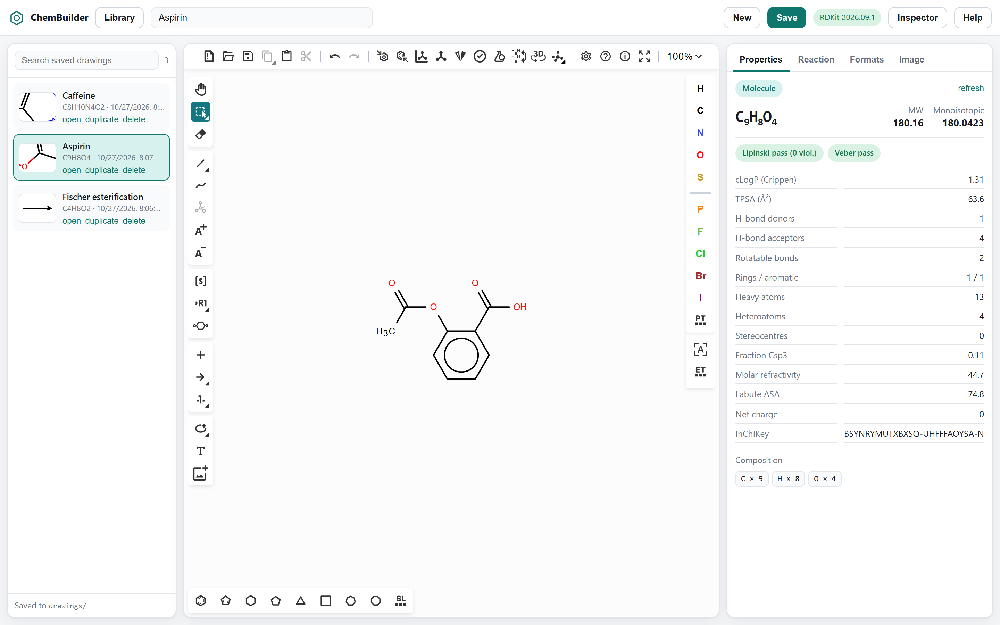
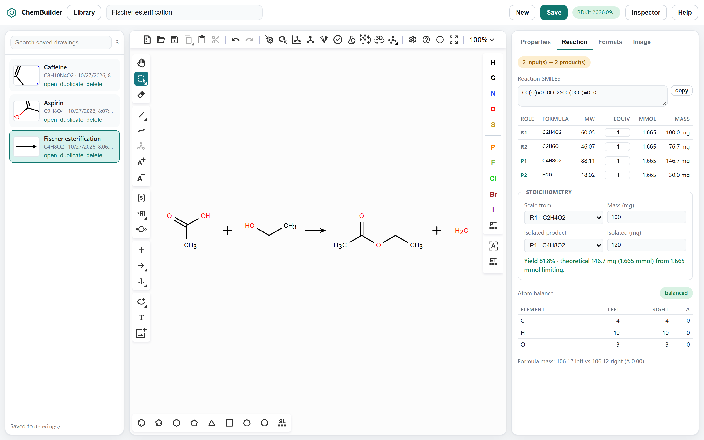

# ChemBuilder

Draw molecules and reaction schemes on your own machine, with live
properties, atom balance, stoichiometry and exports. No account, no
network calls, nothing leaves the box.

ChemBuilder is a small shell around two open-source engines: the
[Ketcher](https://github.com/epam/ketcher) structure editor for drawing,
and [RDKit](https://github.com/rdkit/rdkit) compiled to WebAssembly for
the chemistry. A zero-dependency Node server serves the app and keeps
your drawings as plain files in a folder you own.



## Quick start

You need [Node.js](https://nodejs.org) 18 or newer. Nothing else is
installed.

```
git clone https://github.com/PaunShop/ChemBuilder.git
cd ChemBuilder
npm start
```

`npm start` starts the server and opens your browser. On Windows you can
also double-click **`ChemBuilder.cmd`**. To start the server without
opening a browser, run `node server.js`.

The server binds to `127.0.0.1` on port 8731 and walks up to 8740 if
that port is busy; set `CHEMBUILDER_PORT` to pin one. The first load
takes a few seconds while the editor and the chemistry engine (about
38 MB together) are fetched; they are cached after that.

Three example drawings ship in `drawings/`, so the library is not empty
on first run.

## Features

**Drawing** is the Ketcher editor, embedded whole: atoms, bonds, rings,
templates, stereo, charges, R-groups, S-groups (including polymer SRUs),
text annotations, reaction arrows, plus signs and reagents written over the
arrow. Multi-step schemes work.
Paste a SMILES string or a MOL block straight onto the canvas. Polymer
repeat units are native SRU S-groups: select the repeat-unit atoms, choose
**S-Group**, set **Type** to **SRU polymer**, enter a label such as `n`,
and choose the repeat pattern. The Properties panel also lets you set the
repeat-unit label to a letter such as `N` or `M`; it is shown beside the
brackets and saved with the structure.
For a single SRU that covers the complete structure, the Properties panel
also estimates chain molar mass from a degree of polymerization and an
optional net end-group contribution. It does not infer a full-polymer
formula or account for molecular-weight distribution.

**Properties** update as you draw:

| | |
|---|---|
| Identity | Hill formula, net charge, composition, InChI, InChIKey, canonical SMILES |
| Mass | molecular weight, monoisotopic mass |
| Drug-likeness | cLogP, TPSA, H-bond donors and acceptors, rotatable bonds, Lipinski and Veber verdicts |
| Shape | rings, aromatic rings, heteroatoms, stereocentres, fraction Csp3, molar refractivity, Labute ASA |

A half-drawn structure that RDKit cannot sanitize still reports its
composition, with a note saying the rest is unavailable.

**Reaction schemes** get their own panel: the reaction SMILES, a
component table split into reactants, products and reagents over the
arrow, and a per-element atom balance that says whether the scheme is
balanced and by how much it is off.

**Stoichiometry** sits under the component table. Pick a reactant, enter
a mass, set equivalents per component, and the table fills in mmol and
mass for everything. Enter the isolated mass of a product for a yield. A
multi-step scheme is analysed as its overall transformation.



**Exports**

- Text: SMILES, extended SMILES, SMARTS, MOL V2000 and V3000, SDF,
  RXN V2000 and V3000, CML, KET, InChI, InChIKey. Copy or save each one.
- Image: PNG and SVG at any width, keeping the drawing's own aspect, with
  the height field acting as a cap. Optional transparent background.
  "Copy PNG" puts the image on the clipboard for pasting into slides or
  a document.

**Library.** Save a drawing and it lands in `drawings/` as three plain
files: a `.ket` with the structure, a `.json` with the metadata and an
`.svg` thumbnail. The sidebar lists them with search, duplicate and
delete; click an entry to open it. There is no database, so the folder
is yours to back up, diff or sync.

**Nothing is lost by accident.** Unsaved work is kept in browser
storage, so a refresh or an accidental close does not lose the canvas.
The app asks before replacing an unsaved canvas with a new or opened
drawing, the tab title shows a dot while there are unsaved changes, and
if the server stops a banner says so while drawing carries on.

**Help.** The Help button in the top bar (or `F1`) opens a short guide
and the shortcut list.

## Keyboard

| Key | Action |
|---|---|
| `Ctrl` `S` | Save |
| `Ctrl` `Alt` `N` | New drawing |
| `Ctrl` `B` | Toggle the library |
| `Ctrl` `I` | Toggle the inspector |
| `F1` | Help and shortcuts |

The editor has its own shortcuts, listed under its help button on the
canvas toolbar.

## How it is put together

```
server.js        zero-dependency HTTP + JSON API, loopback only
app/             the shell: index.html, app.js, chem.js, app.css
vendor/ketcher   Ketcher 3.18.0 standalone build
vendor/rdkit     RDKit 2026.09.1 compiled to WebAssembly
drawings/        saved work, one .ket + .json + .svg per drawing
```

`app/chem.js` is the only file that talks to RDKit. `app/app.js` owns
the editor bridge, the library, the inspector and the export paths.
There is no build step: edit a file and reload the page.

## Good to know

- **Reaction analysis reads the reaction SMILES**, so anything the editor
  cannot express in SMILES (free-text labels over an arrow, say) is not
  counted in the balance.
- **The balance checks atoms, not chemistry.** An unbalanced verdict
  usually means a reagent or by-product is missing from the drawing,
  which is exactly what it is there to catch.
- **Attachment points** (the editor's `*` atom) show as `R` at the end of
  a formula and in the composition, and are not counted as heavy atoms.
- **Macromolecule mode** (the editor's own sequence/polymer view) has no
  SMILES or MOL representation, so the inspector panels report those
  formats as unavailable while it is on.
- **Polymer SRU groups** are stored as structural data, not text brackets.
  KET, MOL/SDF V2000/V3000, CML and CXSMILES retain the bracket and repeat
  label. Chemistry properties, InChI and canonical SMILES describe the drawn
  repeat unit; RDKit cannot infer properties such as the molecular mass of
  the full polymer.
- **Polymer mass estimates** use `degree of polymerization × repeat-unit
  molecular weight + net end-group contribution`. They are shown only for
  one SRU covering the complete structure and do not account for dispersity,
  conversion or other polymer populations.
- **Clipboard image copy** needs the browser's clipboard permission and a
  recent Chrome, Edge or Firefox.

## Licence

ChemBuilder is released under the Apache License 2.0; see `LICENSE`.

It embeds two open-source libraries, unmodified:

- **Ketcher** by EPAM Systems, Apache License 2.0 — `vendor/ketcher/LICENSE.txt`
- **RDKit** by Greg Landrum and contributors, BSD 3-Clause — `vendor/rdkit/LICENSE.txt`

See `NOTICE.md` for the details of what each one provides.
